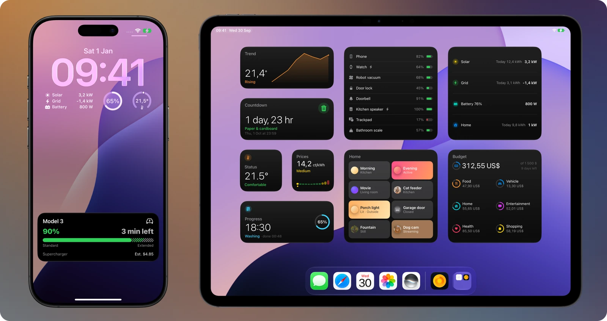
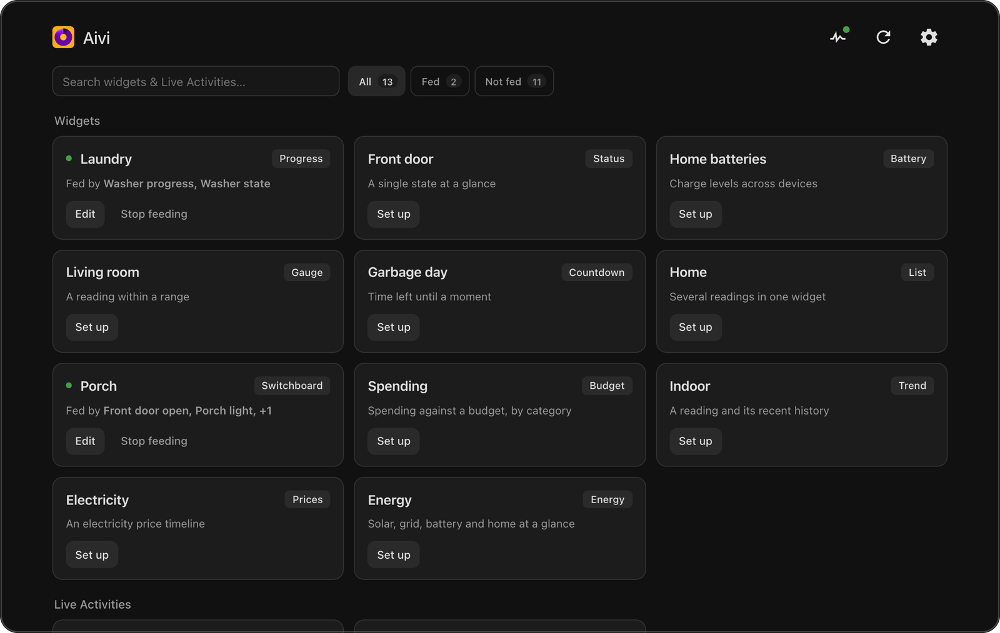
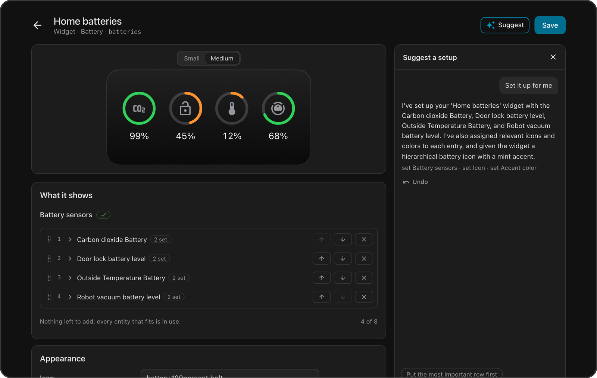

# Aivi for Home Assistant

Show your Home Assistant entities in iPhone widgets and Live Activities,
through the [Aivi app](https://apps.apple.com/app/aivi/id6749237387).
Design a widget in the app, choose the entities that feed it in the Aivi
panel in Home Assistant, and it stays up to date. No YAML, no automations.

**You need:**

- Home Assistant 2025.4 or newer, with [HACS](https://hacs.xyz)
- The Aivi app on an iPhone (iOS 26 for widgets, iOS 18.4 for Live Activities)
- An Aivi subscription: [$2.99 a month or $23.99 a year](https://getaivi.app/#pricing),
  first week free

The integration itself is free and open source. It needs no Home Assistant
Cloud, remote access or open port.

The [guide](https://docs.getaivi.app/home-assistant/integration/) covers
setup step by step, Live Activities, buttons on your Home Screen,
troubleshooting and removal.

## Install

1. On Home Assistant 2026.11 and newer, go to **Settings → Marketplace →
   Add from link** and paste `https://github.com/getaivi/home-assistant`.
   On 2026.10 and older, add that link in HACS as a custom repository of
   type *Integration*, or use the button above.
2. Download **Aivi** and restart Home Assistant.
3. Go to **Settings → Devices & services → Add integration → Aivi** and
   paste your API token from the Aivi app.

Without HACS: download `aivi.zip` from the
[latest release](https://github.com/getaivi/home-assistant/releases/latest)
and unpack it into `config/custom_components/aivi/`.

## Your first widget

1. Create a widget in the Aivi app and add it to your Home Screen.
2. Open **Aivi** in the Home Assistant sidebar and select the widget.

   

3. Choose an entity for each field. The preview shows the widget as you go.
   Save, and the widget follows those entities from then on.

   

## What it does

- **A form for every template, with a live preview.** Status, Progress,
  Gauge, Countdown, List, Battery, Budget, Trend, Prices, Energy,
  Showcase, Switchboard and Remote widgets, and Progress, Monitor and
  Remote Live Activities. Colors, icons and formatting are optional.
- **Starts from what Home Assistant already knows.** A Trend draws its line
  from recorded history, Prices reads your price sensor's timeline (Nord
  Pool, ENTSO-e, Octopus Energy and the like), Energy starts wired like
  your Energy dashboard, and a Budget starts in your currency.
- **Buttons and switches on your Home Screen and Lock Screen.** A
  Switchboard turns lights, switches, locks, garage doors, thermostats,
  scenes and scripts into tiles. A Remote puts a few buttons next to a
  picture and a reading, such as a car's lock and climate, as a widget or
  as a Live Activity. Pressing one acts in Home Assistant and the button
  shows the new state. Each widget or Live Activity with buttons also has
  an event entity to automate on, and presses appear in the logbook.
- **Any value.** A field can follow an entity's state, one of its
  attributes, a fixed value or a template. A color can change with a
  reading, such as red below 20, orange up to 50 and green above.
- **Suggest.** With an AI model set up for Home Assistant's AI Task, a
  plain sentence becomes a filled-in form that you can preview, adjust and
  undo. Nothing is saved until you save it.
- **Watch it from Home Assistant.** Each account has a Subscription
  sensor (with when it ends) and a Health sensor that reports a problem
  when a widget stops updating, so an automation can tell you. The panel's Log
  page lists every push to Aivi and every press, with what was sent and
  any error. It starts over when Home Assistant restarts, unless you
  choose to keep it.
- **Your language.** The integration follows your Home Assistant language:
  English, German, French, Spanish, Italian, Polish, Brazilian Portuguese,
  Japanese and Simplified Chinese.
  [Corrections and new languages are welcome](CONTRIBUTING.md#translating).

## What leaves Home Assistant

Only the content of the widgets and Live Activities you set up: the values,
labels, icons and colors you chose, and an ID for each button or tile. It
is sent to Aivi's API, which delivers it to your devices. Presses come back
over a connection Home Assistant opens itself.

Suggest sends your request and the names of your entities to the AI model
you configured in Home Assistant, not to Aivi. Diagnostics downloads have
the API token removed.

## Help

- Setup and troubleshooting: the [guide](https://docs.getaivi.app/home-assistant/integration/)
- A bug in the integration or its panel: [open an issue](https://github.com/getaivi/home-assistant/issues)
- The app, your account or subscription: [Aivi support](https://docs.getaivi.app/support/)

Contributions are welcome: see [CONTRIBUTING.md](CONTRIBUTING.md).
This project is not affiliated with Home Assistant or Nabu Casa. iPhone,
iOS and SF Symbols are trademarks of Apple Inc.
